# GammaOS Pico Tool

The all-in-one desktop tool for **GammaOS Pico** on the **Konkr Pocket Advance** and the **Konkr
Pocket Block**, for Windows, macOS and Linux. It sets up and updates the microSD card, lists your games exactly the way the console
does and puts box art on the card, and backs up, updates and restores the console's bootloader.

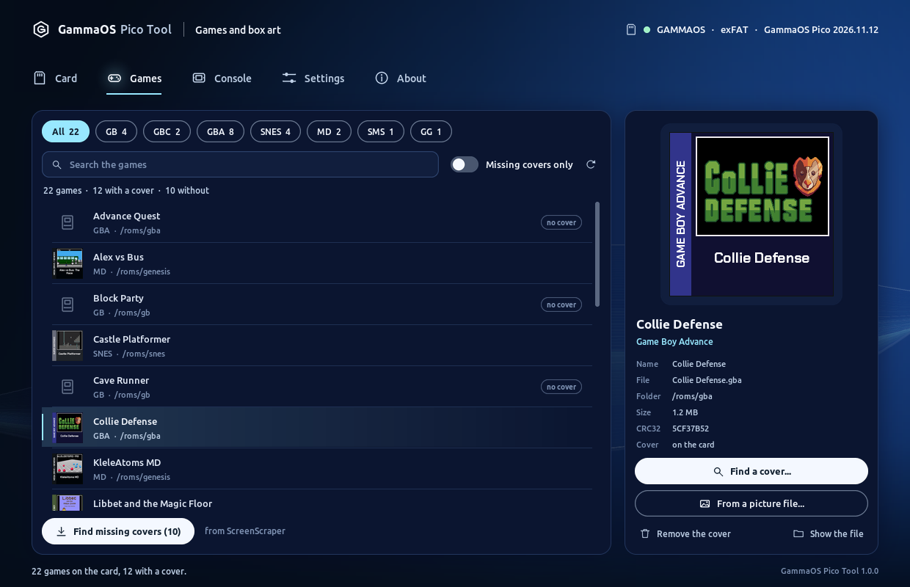

## Read this first

> [!CAUTION]
> **GammaOS Pico is a custom bootloader, and this tool can write it. Both are experimental software,
> provided as they are, with no warranty of any kind.** Writing a bootloader (`lk_a` and `lk_b` on
> the Pocket Advance, `lk_a` on the Pocket Block) can leave a console that does not start, and you
> do it entirely at your own risk. Nobody involved is responsible for a bricked or damaged console,
> lost data, or anything else that comes from using them. The tool backs the console's bootloader up before its first write, but **nothing is
> guaranteed**.

> [!WARNING]
> **The console's Android stays, but Android's over-the-air (OTA) updates may stop working** while
> GammaOS Pico's bootloader is installed, and an OTA may also replace it. **Update the console's
> Android to its latest version before you install GammaOS Pico.** Keep the console charged and
> connected while the tool writes to it.

> [!IMPORTANT]
> **GammaOS Pico and this tool are released as they are.** They are not community projects:
> **feature requests, issues and pull requests are not accepted**, and there is no support channel
> here. Use them as they are, or not at all.

## Download

The [**Releases**](../../releases) page has one file per system. Download it and run it; there is
nothing to install.

| System | File |
|---|---|
| Windows (64-bit) | `gammaos-pico-tool-windows-x86_64.exe` |
| macOS (Apple silicon) | `gammaos-pico-tool-macos-arm64` |
| macOS (Intel) | `gammaos-pico-tool-macos-x86_64` |
| Linux (x86_64) | `gammaos-pico-tool-linux-x86_64` |

On macOS and Linux, make the file executable first (`chmod +x gammaos-pico-tool-*`). On macOS,
the first time, right-click it and choose **Open**.

## What it does

### The card

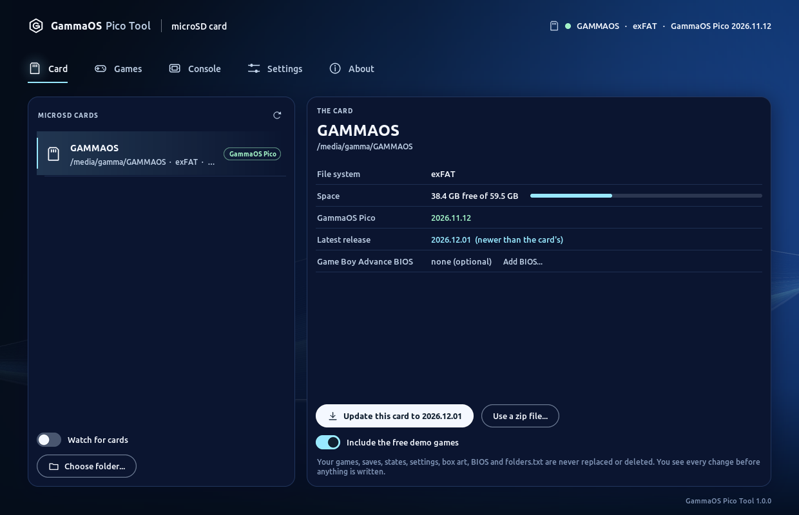

- Finds the removable cards on the computer (or any folder you pick), shows their file system and
  free space, and which ones already hold GammaOS Pico and which version.
- Warns when a card is not FAT32 or exFAT and links the wiki's
  [Installing](https://github.com/TheGammaSqueeze/GammaOSPico/wiki/Installing) page for
  formatting it. **The tool never formats a card.**
- **Sets up a new card** or **updates one**: downloads the latest release's card package for your
  console (`gammaos-pico-kpa-<version>-sdcard.zip` for the Pocket Advance,
  `gammaos-pico-block-<version>-sdcard.zip` for the Pocket Block; both hold the same files),
  checks it against the release's `SHA256SUMS`, and shows you every change before anything is
  written. Your console is picked on the Card tab or in Settings, and the tool remembers the one
  it last saw on the Console tab. A package you downloaded before works too (offline).
- An update **never replaces or deletes your files**: settings, `folders.txt`, play time, the
  recently played list, the archive index, saves, states, games, your BIOS, box art,
  `boot.cfg`, your saved Wi-Fi networks and your RetroAchievements account and unlocks
  (`gammaos/net/`, `gammaos/ra/`) all stay as they are. The release's own files in `bios/`, the
  Wi-Fi and Bluetooth firmware (`bios/connsys/`) and HTTPS's trusted roots (`bios/certs/`), are
  brought up to date with it. Each file is written whole (to a temporary file, flushed, then
  renamed), so a card pulled out halfway holds the old file or the new one, never half of one.
- An update **checks that the card really took it**: the card is tested for writes first (a
  locked or read-only card is refused before anything is written), every file written is read
  back from the card and compared with the package, and at the end every file of the package is
  checked on the card again. A file that does not match is written once more; if it still does not
  match, the update stops and names it instead of saying it is done.
- Copies your Game Boy Advance BIOS to `bios/gba_bios.bin` after checking it (16384 bytes, and
  the usual dump's checksum).

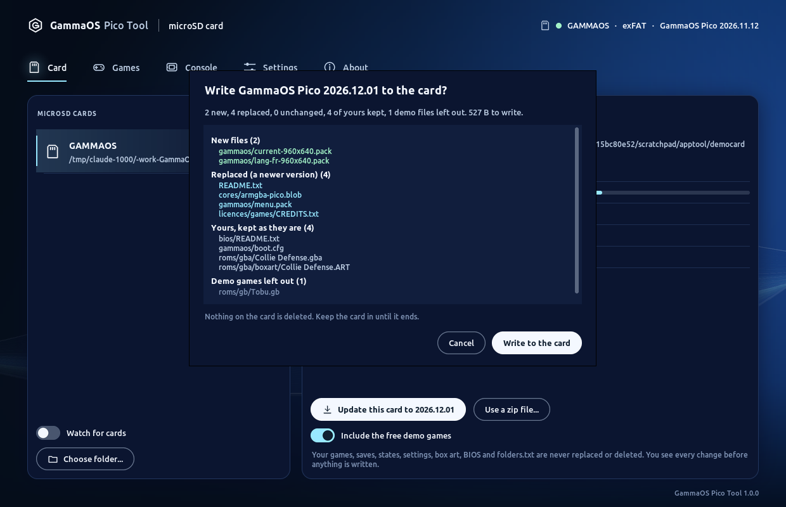

### Games and box art

- Lists the games **exactly as the console does**: the same folders (`roms/<system>`, the card's
  root, ES-DE and EmuDeck layouts, `gammaos/folders.txt`), the same folder names and extensions,
  the same order, a game found twice listed once, `.zip` and `.7z` archives listed as the games
  inside them, and the console's limits. It says which games the console will not start, and
  why (a password-protected archive, a compression it does not open, a game too large).
- Names in any script are shown as they are on the card (accents, Greek, Cyrillic, Japanese,
  Korean, Arabic, emoji), sorted the console's way: accents folded, so "Pokémon" sits with
  "Pokemon", and other scripts after A to Z. Searching ignores accents too.
- Shows each game's cover, and finds the missing ones from **ScreenScraper** (by the ROM's CRC
  and name; release builds have access built in, your own free account adds quota) or
  **TheGamesDB** (with your own API key). Covers are written as the console's own `.ART` files,
  exactly where it reads them, under the game's own name. A cover an older version of GammaOS
  Pico named with a "_" for each letter outside ASCII is still found, as long as no other game
  shares that name.
- Search by hand and pick from the candidates, use any picture file, or remove a cover.
- Stays quick with libraries of tens of thousands of games.

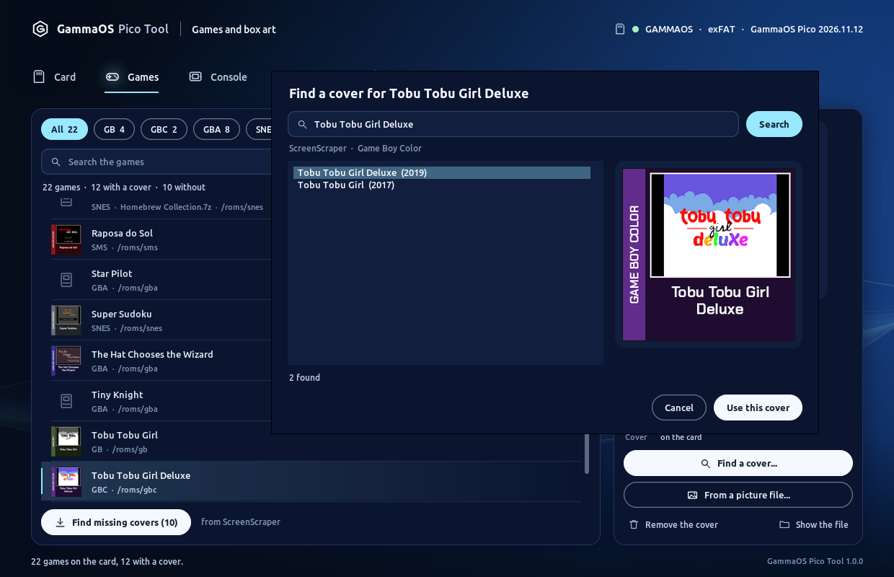

### The console's bootloader

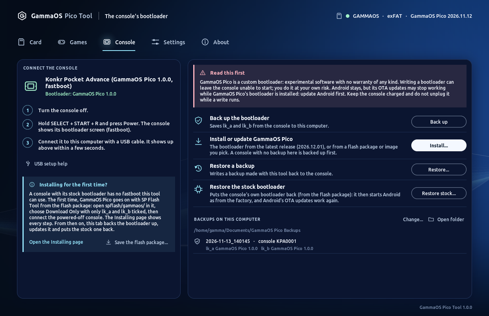

Over GammaOS Pico's own bootloader (hold **SELECT + START + R** while turning the console on, then
connect USB), the tool finds out which console it is and:

- **backs up** its bootloader to this computer: `lk_a` and `lk_b` on the Pocket Advance, `lk_a`
  on the Pocket Block (automatically before the first write to a console it has no backup of),
- **installs or updates** GammaOS Pico's bootloader from the latest release or a flash package or
  image you pick,
- **restores a backup**, or **puts the stock bootloader back**.

Every write asks first, is checked against the image and read back afterwards. On the Pocket Block
only `lk_a` is ever written (its `_b` copies are never used). A bootloader, flash package or backup
made for one console is refused on the other.

> [!NOTE]
> The **first** install on a console with its stock bootloader is done with SP Flash Tool v5 and
> the console's flash package, as the wiki's
> [Installing](https://github.com/TheGammaSqueeze/GammaOSPico/wiki/Installing) page shows step by
> step:
>
> | | Pocket Advance | Pocket Block |
> |---|---|---|
> | SP Flash Tool and MediaTek's USB driver | `gammaos-pico-kpa-windows-tools.zip` | `gammaos-pico-block-windows-tools.zip` |
> | Flash package | `gammaos-pico-kpa-<version>-flash.zip` | `gammaos-pico-block-<version>-flash.zip` |
> | Scatter file (in `spflash/gammaos/`) | `MT6785_Android_scatter.txt` | `MT6768_Android_scatter.txt` |
> | Download Only, ticked | `lk_a` and `lk_b` | `lk_a` only |
>
> The Console tab explains it and can save the flash package for you; from then on, the tool
> takes over.

On Windows the console needs a WinUSB driver, and on Linux a udev rule (both consoles have the
same USB ids): **USB setup help** on the Console tab shows what to do on your system.

## The command line

Everything the window does is also a command, for scripts. With no command, the window opens.

```sh
gammaos-pico-tool cards                                  # the cards on this computer
gammaos-pico-tool status E:\                             # what is on a card, and the latest release
gammaos-pico-tool setup /media/me/GAMMAOS --yes          # put GammaOS Pico on a new card
gammaos-pico-tool update /media/me/GAMMAOS --dry-run     # list what an update would change
gammaos-pico-tool update /media/me/GAMMAOS --zip gammaos-pico-kpa-2026.12.01-sdcard.zip --yes
gammaos-pico-tool setup /media/me/GAMMAOS --console block --yes   # the Pocket Block's card package
gammaos-pico-tool bios /media/me/GAMMAOS gba_bios.bin
gammaos-pico-tool scan /media/me/GAMMAOS --missing       # games without a cover (--json for scripts)
gammaos-pico-tool scrape /media/me/GAMMAOS --system gba  # find the missing covers
gammaos-pico-tool art set /media/me/GAMMAOS "Collie Defense" cover.png
gammaos-pico-tool art rm /media/me/GAMMAOS "Collie Defense"
gammaos-pico-tool console detect                         # which console, and its bootloader
gammaos-pico-tool console backup
gammaos-pico-tool console flash --zip gammaos-pico-kpa-2026.12.01-flash.zip
gammaos-pico-tool console flash --zip gammaos-pico-block-2026.12.01-flash.zip
gammaos-pico-tool console restore "~/Documents/GammaOS Pico Backups/<console>/<date>"
gammaos-pico-tool console stock
gammaos-pico-tool check-network                          # can GitHub and ScreenScraper be reached securely
```

`gammaos-pico-tool <command> --help` lists each command's options.

`check-network` reaches GitHub and ScreenScraper once each over HTTPS and says where the
certificates came from. It exits with status 1 when a secure connection fails its checks, or when
GitHub cannot be reached. The tool checks certificates against the operating system's own trust
store (Keychain on macOS, the Windows certificate store, the distribution's CA bundle on Linux),
and against the certificate list it carries (certifi) when that is not available.

## More screenshots

| | |
|---|---|
| 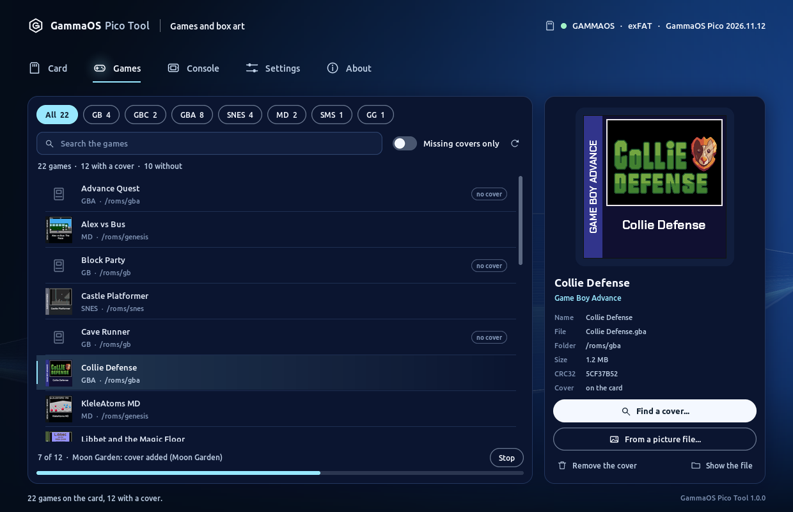 | 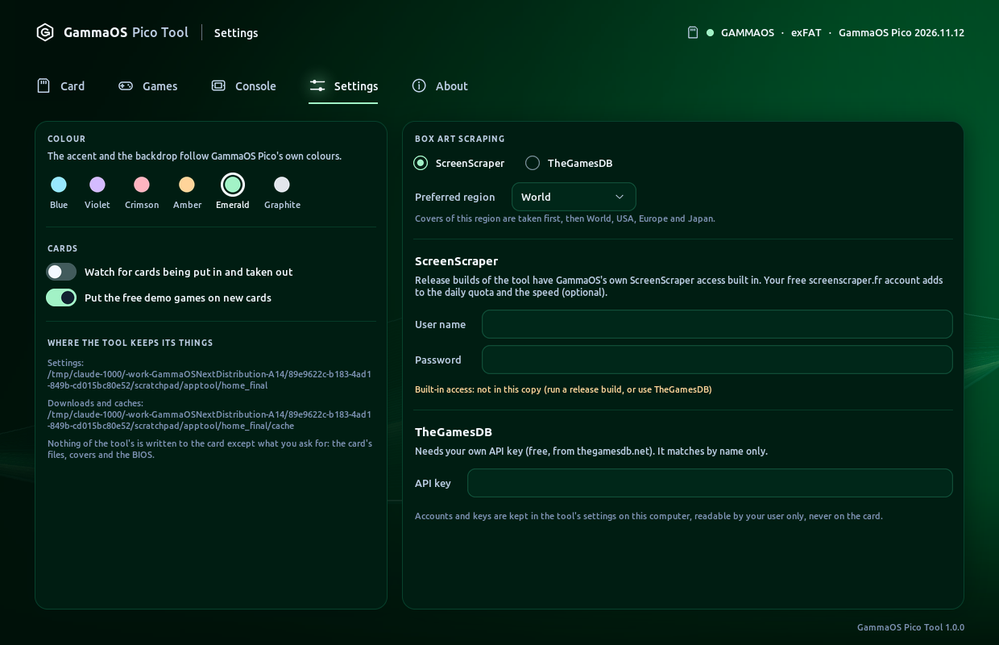 |
| 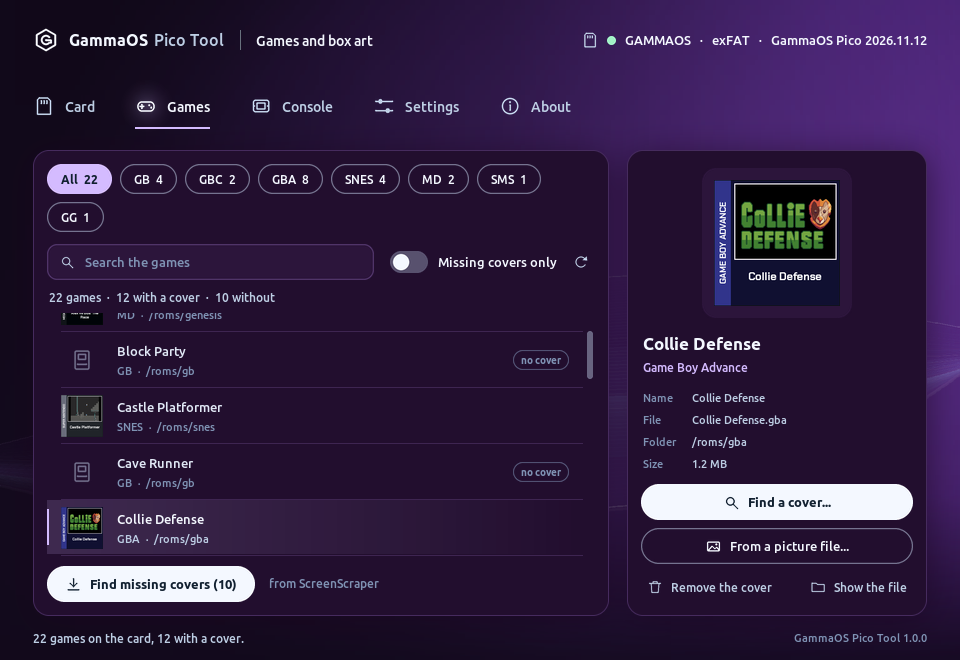 | 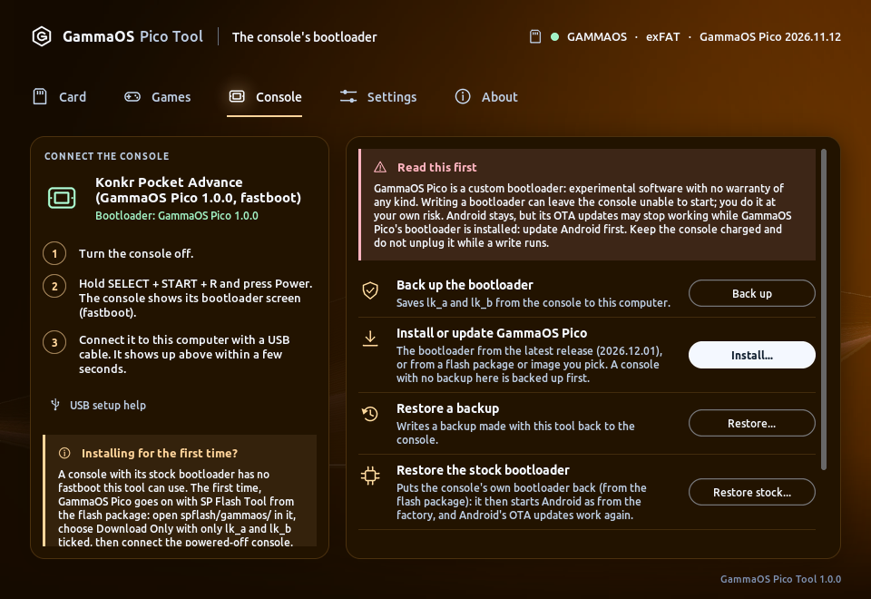 |
| 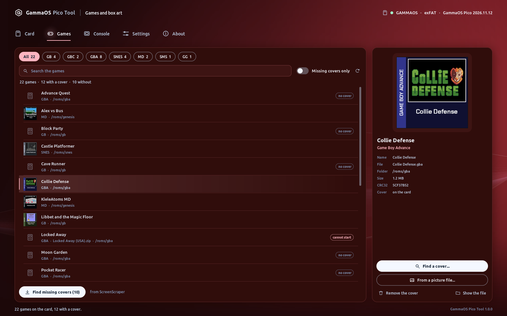 | 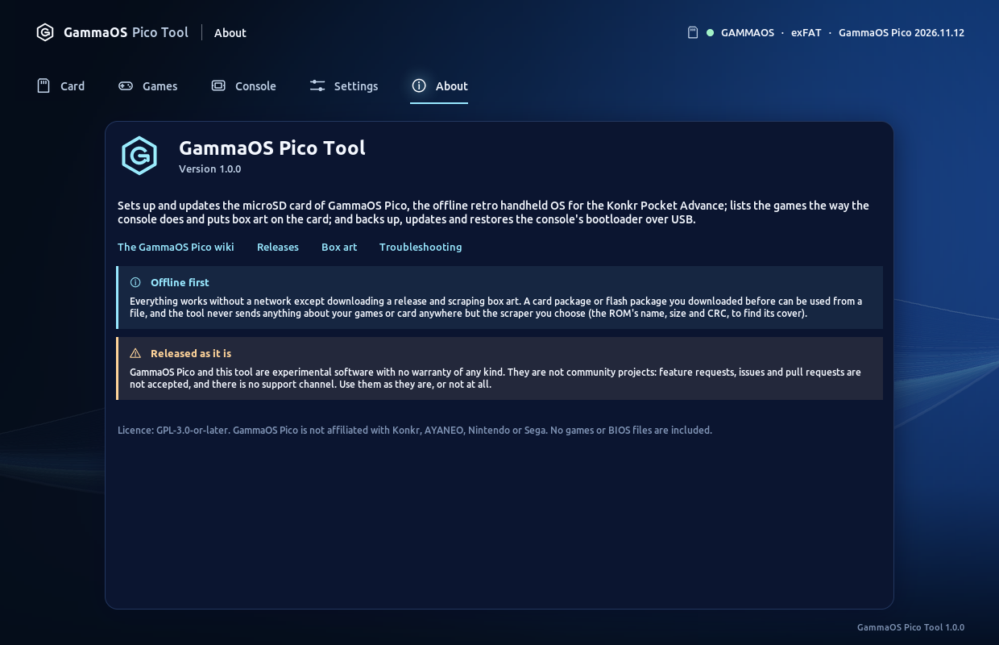 |

The window follows GammaOS Pico's "Current" theme, in its accent colours (Settings > Colour), and
adapts to any window size and to high-DPI screens.

## Offline first

Everything works without a network except downloading a release and scraping box art. Card and
flash packages you downloaded before can be used from a file. The tool sends nothing about your
games or your card anywhere but to the scraper you choose (a ROM's name, size and CRC, to find its
cover). Its settings and caches stay on your computer, never on the card:

- Windows: `%APPDATA%\GammaOS Pico Tool`
- macOS: `~/Library/Application Support/GammaOS Pico Tool`
- Linux: `~/.config/gammaos-pico-tool`

## Running from source

Python 3.9 or later with Tkinter (3.10 or later to use the system's trust store through
`truststore`; older versions use `certifi`'s list):

```sh
pip install .
gammaos-pico-tool
```

Dependencies: `pillow`, `pyusb`, `libusb-package`, `truststore` (Python 3.10 and later) and
`certifi`. The release binaries are built with PyInstaller as in `.github/workflows/release.yml`.

Tests: `pip install pytest`, then `python -m pytest` (on a headless Linux, `xvfb-run -a python -m pytest`).
With the [lk-mt6785](https://github.com/TheGammaSqueeze/lk-mt6785) sources next to it (or
`GAMMAOS_PICO_LK` pointing at them), the tests also build the console's own card scanner and check
that the tool lists FAT32 and exFAT card images game for game the same way.

## Licence

GPL-3.0-or-later (see `LICENSE`). GammaOS Pico is not affiliated with Konkr, AYANEO, Nintendo or
Sega. No games or BIOS files are included: use your own.
